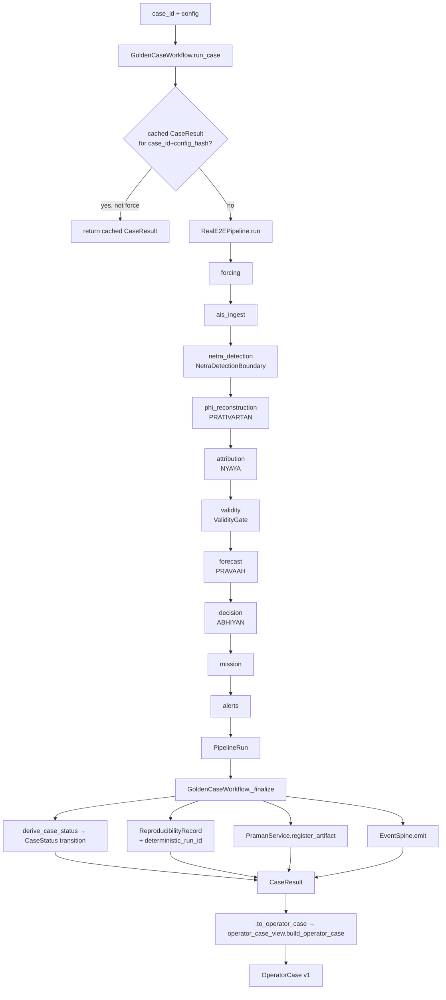

# Case Orchestration Reconciliation

This is the architecture-level companion to
`reports/cases/GOLDEN_CASE_ENGINE_REPORT.md`, which is the implementation
report and the authoritative account of what was built, why, and what it cost.
This document does not repeat that account — it exists because the task that
produced the engine asked for a standing architecture reference at this path,
separate from the point-in-time report. Where the two could drift, the report
is the implementation record and this file is the map; if you are auditing
what actually happened, read the report.

**Building `packages/varuna_domain/golden_case_engine.py` is not this
document's job and was not redone here.** Two independent case-orchestration
surfaces existed in this repository — `varuna_domain.CaseWorkflow` (lifecycle,
persistence, PRAMAN, event spine) and `varuna_integration.RealE2EPipeline`
(producer boundaries, real forcing, evidence-mode propagation) — built by two
different sessions, neither aware it was solving half of the same problem
until a third session (`router-datasets-65`) reconciled them by building
`GoldenCaseWorkflow` as an adapter over both, unmodified. This document
records that reconciliation from the architecture side; the engine itself,
its tests, and its limitations are `65`'s report to own.

## 1. What existed, and why a third path was the wrong instinct

| Surface | Owns | Missing |
|---|---|---|
| `varuna_domain.CaseWorkflow` | `CaseStatus` lifecycle, `Case` persistence, PRAMAN artifact registry, `EventSpine` | No detection stage — takes slick points as *input*. Synthetic forcing only (`reconstruct_origin()` called with no `current`/`wind`/`input_envelope`). |
| `varuna_integration.RealE2EPipeline` | Ten real producer stages (forcing → alerts), `NetraDetectionBoundary` freeze gate, real ERA5/CMEMS, `EvidenceMode` propagation, fail-closed reasons | No lifecycle states, no persistence, no idempotency. `run_id` is `RUN-{datetime.now()}-{uuid4()[:6]}` — random by construction. |

A third orchestrator would have meant a third `OperatorCase` projection, a
third notion of "what does BLOCKED mean here," and a third place for evidence
mode to be silently mishandled — exactly the failure this reconciliation
exists to prevent. The only architecturally sound move was an adapter: reuse
`CaseWorkflow`'s persistence pattern (`CaseRepository`/`ArtifactRepository`/
`EventRepository`, `PramanService`, `EventSpine`) and `RealE2EPipeline`'s
`.run()` as a black box, and add only the layer that neither had: an explicit
case lifecycle *driven by* pipeline stage results, plus idempotency and
reproducibility. That layer is `GoldenCaseWorkflow`.

## 2. Canonical ownership

One line per responsibility named in the reconciliation task. "Canonical
owner" is the module a caller should import from; everything else either
delegates to it or must not exist.

| Responsibility | Canonical owner | Notes |
|---|---|---|
| Case lifecycle | `varuna_domain.entities.CaseStatus`, walked by `golden_case_engine.derive_case_status()` | Extended additively (26 insertions, 0 deletions) with BLOCKED/UNAVAILABLE/OOD terminal states on top of the pre-existing CREATED→COMPLETED walk. |
| Case persistence | `varuna_domain.ports.CaseRepository` + `Case` entity | Unchanged, reused as-is. |
| Artifact registry | `varuna_praman.praman.PramanService` | Unchanged, reused as-is. |
| Event spine | `varuna_pravaah.event_spine.EventSpine` | Unchanged, reused as-is. |
| Detection | `varuna_integration.netra_boundary.NetraDetectionBoundary` (`FrozenCheckpointNetraProvider` / `SimulatedSlickProvider`) | First-class producer boundary; `GoldenCaseWorkflow` never calls NETRA directly. |
| Observation | `RealE2EPipeline._detect()` reading the event manifest | Not a separate stage from detection — the manifest names the tiles, detection reads them. |
| Real forcing | `varuna_integration.forcing.load_event_forcing()` → `CubeBackedCurrentField`/`CubeBackedWindField` | On the golden-engine REAL path this is what actually runs — see §5. |
| Reconstruction (PRATIVARTAN) | `varuna_prativartan.ensemble.run_backward_ensemble()` via `pipeline._reconstruct_phi()` | Unchanged. |
| AIS | `varuna_integration.ais_source.EventAISAdapter` | Unchanged; real bronze tracks, fails closed to UNAVAILABLE. |
| Attribution (NYAYA) | `pipeline._attribute()` → `varuna_nyaya.services.NyayaService` | Unchanged. |
| Validity | `varuna_nyaya.services.ValidityService` → `ValidityState` (`varuna_contracts.evidence`) | Unchanged; gate verdict is `PRODUCED`, never `BLOCKED`, when it answers RESTRICTED. |
| Forecast (PRAVAAH) | `pipeline._forecast()` | Unchanged. |
| Recommendation | `apps.api.operator_case_view._recommendation()` | Reads the raw `StageStatus` off stored validity metadata, not the projected `ProducerStatus` — see §4. |
| Mission | `varuna_missions.service.MissionService`, `MissionState` (`varuna_contracts.states`) | Unchanged; `GoldenCaseWorkflow` does not re-implement mission transitions. |
| Alerts | `varuna_alerts.service.AlertService` | Unchanged. |
| `EvidenceMode` | `varuna_contracts.evidence.EvidenceMode` + `varuna_integration.stage.worst_mode()` | Unchanged; monotonic-worsening only. |
| `StageStatus` | `varuna_integration.stage.StageStatus` | Unchanged (`PRODUCED`/`NOT_YET_PRODUCED`/`BLOCKED`) — answers "did the stage execute," never conflated with `ValidityState`. |
| `ValidityState` | `varuna_contracts.evidence.ValidityState` | Unchanged (`VALID`/`DEGRADED`/`RESTRICTED`/`INCONCLUSIVE`) — answers "what did the gate conclude." |
| Provenance | `varuna_integration.case_bridge` (stage-level) + `golden_case_engine.ReproducibilityRecord` (run-level) + `apps.api.operator_case_view._provenance()` (case-level rollup, merges both) | Three layers, not one — see §6. |
| Idempotency | `GoldenCaseWorkflow._cached_result()`, keyed on `(case_id, config_hash)` | A second call with an equal-by-content config reuses the prior `CaseResult`, including its missions/alerts, unless `force=True`. |
| Run identity | `golden_case_engine.deterministic_run_id()` | See §7 — added on top of `65`'s engine to close the one gap their own report flagged as open. |
| Model resolution | `varuna_integration.netra_boundary.resolve_netra_boundary()` + `NetraModelSpec` + `CheckpointFreezeStatus` | `allow_simulated` is code-only, never config-driven — see §8 for what is and is not verified before inference. |
| Preprocessing compatibility | **Not yet enforced anywhere** | See §8 — a real, open gap, not silently patched. |

Three vocabularies stay separate on purpose (`StageStatus`, `ValidityState`,
`EvidenceMode`), because they answer three different questions — "did it
run," "what did it conclude," "how real was the input." Collapsing them was
considered and rejected during the mission/alert reconciliation this same
session did in parallel (`router-datasets-3f`'s task): the new-prompt
vocabulary `VALID/RESTRICTED/BLOCKED/UNAVAILABLE` is *behavior required of*
these three enums, not a fourth enum to add.

## 3. Call graph



`run_replay_case()` is the same diagram from `RealE2EPipeline.run` onward,
substituting a canned `PipelineRun` from `varuna_domain.replay_fixtures` for
the boxes E–O. Everything from `_finalize` down is identical code, which is
the guarantee that REPLAY is not a second demo pipeline.

## 4. State model

Kept as three separate vocabularies, per the mandatory findings this task
named. None is collapsed into another.

**A. `StageStatus`** (`varuna_integration.stage`) — did the stage execute:

```
PRODUCED | NOT_YET_PRODUCED | BLOCKED
```

Deliberately not richer than this. `NOT_YET_PRODUCED` covers both "no
detection above threshold" (a valid scientific result) and "upstream
unavailable" — the *reason string* distinguishes them, not the enum value,
because adding states for every reason would make the enum re-derive what the
reason field already says.

**B. `ValidityState`** (`varuna_contracts.evidence`) — what the gate
concluded:

```
VALID | DEGRADED | RESTRICTED | INCONCLUSIVE
```

All four preserved. `DEGRADED` ("actionable with caveats shown to the
officer") and `INCONCLUSIVE` (a first-class scientific outcome) are not in
the abbreviated `VALID/RESTRICTED/BLOCKED/UNAVAILABLE` vocabulary some task
prompts use as shorthand — that shorthand is a *subset*, and reading it as a
replacement would silently lose both.

**C. `EvidenceMode`** (`varuna_contracts.evidence`) — how real the input was:

```
REAL | SIMULATED | UNAVAILABLE
```

Combines only by monotonic worsening (`worst_mode()`); never promoted back.

**D. `CaseStatus`** (`varuna_domain.entities`, extended by this
reconciliation) — the lifecycle a case has walked, which is the layer that
was genuinely missing before this work:

```
CREATED → INGESTED → DETECTING → RECONSTRUCTING → ATTRIBUTING →
EVALUATING → COMPLETED
                              ↘ BLOCKED / UNAVAILABLE / OOD / FAILED / QUARANTINED
```

`derive_case_status()` walks this from the `PipelineRun`'s actual stage
results — it is a *projection* of `StageStatus` outcomes onto a lifecycle,
not a fifth independent vocabulary. A `NOT_YET_PRODUCED` detection with
reason `NO_SLICK_DETECTED` derives to a distinct terminal state from a
`BLOCKED` forcing stage, even though both are "the case didn't reach
COMPLETED" — this is precisely the distinction `_recommendation()` in
`operator_case_view.py` also preserves by reading raw `StageStatus` rather
than the collapsed `ProducerStatus` projection: a restricted-but-successful
gate is not the same fact as a stage that failed to run.

## 5. Real vs. simulated boundary

`EngineMode` (`REAL`/`REPLAY`/`SIMULATED`) is recorded on every
`ReproducibilityRecord`, never branched on for scientific behavior — what
differs between a REAL and a SIMULATED run is only which
`NetraDetectionBoundary` the caller constructed via `resolve_netra_boundary()`
before calling `run_case()`, exactly as that function already requires
`allow_simulated=True` to be passed in code. There is no config flag that
flips a real run into a simulated one.

On the REAL path today: forcing is real (ERA5/CMEMS), AIS is real (bronze
MarineCadastre tracks), and detection is real *if* a frozen, hash-verified
checkpoint is supplied — synthetic forcing is not silently substituted
anywhere in this path. What is **not yet true**, and is called out rather
than glossed over: `varuna_domain.CaseWorkflow.reconstruct()` (the pre-existing,
still-present method, orthogonal to `GoldenCaseWorkflow`) calls
`reconstruct_origin()` with no `current`/`wind`/`input_envelope`, so *that*
path still runs synthetic forcing under a `SIMULATED` envelope. It is not
wrong — nothing is mislabelled — but it means two case-shaped entry points
now coexist with different forcing realism, and only one of them
(`GoldenCaseWorkflow`) is canonical going forward.

## 6. Provenance flow

Three layers, each answering a different question, matching the
`StageStatus`/`ValidityState`/`EvidenceMode` separation:

1. **Per-stage** (`case_bridge.apply_run_to_case()`): what each stage's
   `detail` dict reported — `model_version`, `source_id` — collected into
   `case.metadata["pipeline_provenance"]`.
2. **Per-run** (`golden_case_engine.ReproducibilityRecord`): `run_id`,
   `deterministic_run_id`, `model_version`, `checkpoint_hash`,
   `preprocessing_version`, `dataset_version`, `config_hash`, `code_version`,
   timestamps — everything needed to reproduce or audit *this specific
   execution*, independent of any one contract object.
3. **Per-case rollup** (`operator_case_view._provenance()`): merges the
   PRAMAN artifact registry with `pipeline_provenance`, so a case produced by
   `GoldenCaseWorkflow` (which registers PRAMAN artifacts via `_finalize`)
   and a case produced by the raw pipeline (which does not) both surface
   correct lineage in `OperatorCase.provenance` — additive merge, never a
   replacement, so `CaseWorkflow`-produced cases are unaffected.

## 7. Idempotency and run identity — two different guarantees

The task's mandatory findings ask for both, and they are not the same thing:

- **Idempotency** (a repeated call must not re-execute or duplicate side
  effects): `GoldenCaseWorkflow._cached_result()`, keyed on
  `(case_id, config_hash)`. A second `run_case()` call with an
  equal-by-content `PipelineConfig` returns the prior `CaseResult` — same
  missions, same alerts, nothing re-created — unless `force=True`. This part
  was correct and complete before this document was written.
- **Run identity** (a stable name for "this configuration of this case"
  independent of *when* it happened): this was the one gap `65`'s own report
  flagged as open. `PipelineRun.run_id` (inside `varuna_integration.pipeline`,
  untouched by this reconciliation) is
  `RUN-{datetime.now():%Y%m%dT%H%M%SZ}-{uuid4().hex[:6]}` — a wall-clock- and
  randomness-derived *execution-instance* identifier, useful for correlating
  logs to one process run, and deliberately left alone rather than reshaped
  under a pipeline this reconciliation did not otherwise touch (changing its
  format would ripple into every existing report and test that reads it).

  `golden_case_engine.deterministic_run_id(case_id, engine_mode, config_hash,
  model_version, dataset_version)` is the new, second identity this document's
  work adds: a SHA-256 over exactly those five values, truncated and prefixed
  `CRID-`. Same case, same mode, same config, same model, same dataset →
  same `deterministic_run_id`, on any process, at any time. It is carried as
  a new field on `ReproducibilityRecord`, alongside — not replacing —
  `run_id`. `started_at`/`finished_at` remain where wall-clock execution time
  is recorded, per the task's instruction to keep that separate from
  identity.

## 8. Model contract — what is verified, what is not

Verified before real inference, via `resolve_netra_boundary()` and
`check_checkpoint_frozen()`:

- checkpoint hash, against a `.frozen.json` sidecar (`sha256`, refuses on
  mismatch)
- architecture, encoder, `in_channels`, `classes` — cross-checked against the
  sidecar's own `model_spec` at load time, raises on mismatch
- `model_version`, `dataset_version`, `experiment_id`, `scientific_status` —
  read from the sidecar, not asserted from config

**Not verified anywhere today: preprocessing compatibility.** There is no
`preprocessing_version` field on `NetraModelSpec`, no assertion that a
checkpoint's expected normalization matches what `varuna_integration.forcing`
or the Gold pipeline actually produced. `golden_case_engine.py` works around
this at its own layer — `detector_provider_info()` reports
`ASSUMED_NETRA_PREPROCESSING_VERSION = "netra-norm-v0.2-nodata-excluded"`,
explicitly labelled ASSUMED rather than measured — but that is a case-engine
convenience note, not enforcement. **Nothing in this pipeline currently
rejects an incompatible model/preprocessing combination.** This is the
single most consequential gap this reconciliation surfaced without closing,
because it is exactly the class of defect that would explain a false
negative as cleanly as a genuine one: a checkpoint trained on differently
normalized tiles would also detect nothing, and today nothing would
distinguish that from the real MC20 domain gap. Recorded here as a named,
open item — see the report's Limitations section for the owning-track
recommendation.

## 9. Migration strategy

No migration was required in the disruptive sense — nothing was deleted,
moved, renamed, or had its behavior changed for existing callers:

- `RealE2EPipeline`, `netra_boundary.py`, `ais_source.py`, `forcing.py`,
  `case_bridge.py`, `apps/api/operator_case_view.py` are all untouched by the
  engine build itself (this document's own `deterministic_run_id` addition is
  the one small, additive exception, confined to `golden_case_engine.py`).
- `varuna_domain.CaseWorkflow` is untouched and still callable directly; it
  is not the canonical path going forward, but nothing currently depends on
  it being removed, and removing it is out of scope for a reconciliation
  whose rule is "do not delete."
- `CaseStatus` gained new terminal values additively; no existing value's
  meaning changed.

The practical migration is social, not code: new case-producing call sites
should use `GoldenCaseWorkflow.run_case()` / `.run_replay_case()`, not
`CaseWorkflow.run_full()` or a direct `RealE2EPipeline()` construction. That
is a recommendation for whoever wires the next caller, not an enforced
constraint — nothing here breaks a caller that still uses either underlying
half directly.

## 10. What this document does not cover

Test inventory, exact fixture contents, the six REPLAY case IDs, full
Limitations discussion, and the cross-session coordination record are in
`reports/cases/GOLDEN_CASE_ENGINE_REPORT.md` and this task's own
`reports/cases/CASE_ORCHESTRATION_RECONCILIATION_REPORT.md` — this file is
the architecture map, not the implementation record.
